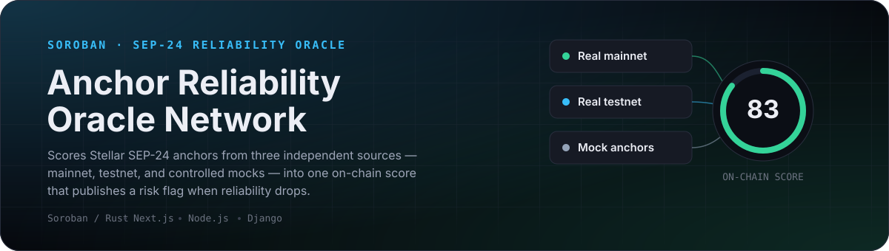
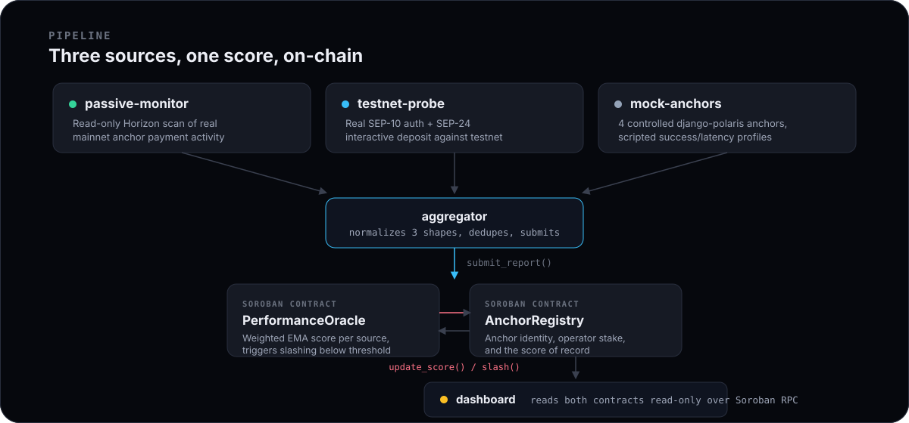

<p align="center">
  
</p>

<p align="center">
  <b><a href="https://monarank.xyz">Live dashboard</a></b> ·
  <b><a href="https://monarank.xyz/scores">Live scores</a></b> ·
  <b><a href="docs/instaward/EVIDENCE.md">Evidence log</a></b> ·
  <a href="#quick-start"><b>Quick start</b></a> ·
  <a href="#how-it-works"><b>How it works</b></a> ·
  <a href="#trust-model"><b>Trust model</b></a> ·
  <a href="#running-the-full-system"><b>Run it locally</b></a> ·
  <a href="#deployed-testnet-contracts"><b>Deployed contracts</b></a> ·
  <a href="#repository-layout"><b>Repository layout</b></a> ·
  <a href="#anchor-onboarding"><b>Apply as an anchor</b></a> ·
  <a href="#docs"><b>Docs</b></a>
</p>

## What is Mona?

Anyone can *claim* a Stellar SEP-24 anchor is reliable. Mona measures it, on-chain, from evidence a wallet or user can't fake:

- **Real mainnet reachability** — does the anchor's live API actually answer a wallet today? Every live SEP-6/24 anchor on mainnet is discovered automatically and checked without moving funds.
- **Real testnet behavior** — does money actually move? A fresh wallet deposits with the anchor (SEP-24 or SEP-6) and, where the anchor offers SEP-6 withdrawals, withdraws back; every payment is checked on the ledger. Testnet anchors get the same read-only checks as mainnet ones first.
- **A reference anchor of our own** — [`ref1.monarank.xyz`](https://ref1.monarank.xyz/.well-known/stellar.toml), a small testnet anchor we run and measure through the same pipeline. Because its `stellar.toml` and signing key are ours, the operator claim and dispute flows are shown on it end to end.

Every anchor gets a **score card** computed from 30 days of those checks: four pillars (availability, speed, integrity, and, for anchors that issue their own fiat asset, how well it holds its peg), a separate **confidence** that says how much was measured, and hard gates that cap the score on an outage or a signing problem. The card is published on a [Soroban](https://developers.stellar.org/docs/build/smart-contracts/overview) contract with the SHA-256 of the inputs it was computed from, and the inputs are published, so anyone can recompute it. The method is in [`docs/SCORING.md`](docs/SCORING.md). The contract publishes the verdict openly; it never slashes or moves anyone's stake. A live dashboard reads it from the chain.

**No single key decides a score.** Two reporter servers, at different providers and in different regions, each measure every anchor and publish their own card. The contract makes a card final only when both have submitted for the same window, and stores the median. Contract upgrades wait 24 hours, the admin is a 2-of-3 multisig account, and an anchor's operator can claim its record with its own `stellar.toml` signing key and dispute a card on-chain. See [Trust model](#trust-model).

Nothing here trades real assets. Mainnet is read-only. Testnet is where every write happens.

## Who this is for

| Who | The problem today | What Mona gives them |
| --- | --- | --- |
| **Wallets and payment apps** routing a user's deposit or withdrawal | The anchor list in a wallet is hand-curated. When an anchor silently stops settling, the wallet finds out from its users | A machine-readable score per anchor, with the evidence behind it — so routing can prefer an anchor that is actually answering today |
| **Users** sending money home or cashing out | "Which anchor should I trust with my money?" is answered by hearsay | A public card per anchor: how available it was, how fast it settled, whether its peg held, and how much of that was actually measured |
| **Anchor operators** | Nothing distinguishes a well-run anchor from a dormant one that still publishes a `stellar.toml` | A neutral, reproducible record of uptime and settlement they can point at, and a way to claim that record and dispute a card they think is wrong. No slashing: a measurement error never costs an operator money |
| **SDF and ecosystem reviewers** | Anchor health is assessed by hand, anchor by anchor | Continuous coverage of every live SEP-6/24 anchor on mainnet (**107 anchors registered on-chain on 24 Nov 2026**: 104 mainnet and 3 testnet), archived and recomputable |

**Why this scales.** Mona does not need an anchor's permission or integration to measure it: everything it checks is public (`stellar.toml`, `/info`, SEP-10, deposit start). Discovery already found and tracks every live SEP-6/24 anchor on mainnet, so coverage grows with the ecosystem rather than with our sales effort. The score is a pure function of a published inputs bundle, so a wallet that does not trust us can recompute every card itself.

## How it works

<p align="center">
  
</p>

1. **Three collectors** run on each of two reporter servers. They independently observe anchor behavior and each emit a normalized `{ success, settlement_seconds, source_type }` report.
2. **`aggregator`** on the primary server dedupes those reports and calls `PerformanceOracle.submit_report()` on testnet, signed by that server's reporter key for the source type. The second server sends no single reports, only score cards.
3. **`PerformanceOracle`** keeps, per report, a weighted exponential moving average and an on-chain health record: a fast and a slow EMA whose gap gives the trend, a consecutive-failure counter, and a 20-report outcome window. Each server's aggregator also computes every measured anchor's **score card** off-chain, for the same one-hour window, and publishes it with `publish_score_card`, together with the hash of its published inputs bundle. The card is that anchor's headline; reports do not overwrite it.
4. **The quorum.** A card joins the anchor's round and waits there (`get_pending_round`). When two distinct authorized reporters have submitted for the window, the oracle stores the field-wise lower median as the final card, records who submitted what (`get_quorum_info`) and updates the registry. If the two scores are further apart than `max_spread`, the card carries `FLAG_REPORTER_DISAGREEMENT` and a `reporter_outlier` event names the reporter further from the median. The oracle flags an anchor at risk when 3 reports in a row fail, when fewer than half of the recent window succeeded, or when the headline reaches 55 (not judged while a card's confidence is under 40), and emits `risk_status_changed` on each transition; with the quorum on, only a final card moves the registry's score or the risk flag.
5. **`AnchorRegistry`** is the source of truth for anchor identity, operator, staked collateral, current score, and whether the anchor is active. It also holds the `SIGNING_KEY` the reporters read from the anchor's `stellar.toml`, which the anchor uses to claim its record.
6. **`dashboard`** reads both contracts straight from Soroban RPC. Score history older than the public RPC's 7-day event window comes from `history-archiver`'s durable archive, fetched server-side and merged in; without it the dashboard still renders, with a shorter chart.

| Source type | Produced by | What "success" means |
| --- | --- | --- |
| `RealMainnet` | `services/mainnet-probe` | The anchor's live stellar.toml, transfer server `/info` and SEP-10 challenge all answer, and a SEP-24 deposit can be started (then abandoned — no funds move). An anchor declining an anonymous wallet by policy still counts as reachable |
| `RealTestnet` | `services/testnet-probe` | The same read-only checks a mainnet anchor gets, then a real deposit (SEP-6 or SEP-24) and, where the anchor offers it over SEP-6, a real withdrawal, each payment verified on the ledger |

### System diagram

```mermaid
%%{init: {'theme':'base','themeVariables':{'fontFamily':'Space Grotesk, ui-sans-serif, system-ui, sans-serif','fontSize':'15px','lineColor':'#7D889B','textColor':'#E9EDF4','clusterBkg':'#11151D','clusterBorder':'#364052','edgeLabelBackground':'#0B0E14'},'flowchart':{'curve':'basis','nodeSpacing':40,'rankSpacing':60,'htmlLabels':true}}}%%
flowchart LR
    ANCH(["Stellar anchors<br/>mainnet read-only · testnet"])

    subgraph COLLECT["Collect"]
        direction TB
        MP["mainnet-probe"]
        PM["passive-monitor"]
        TP["testnet-probe"]
    end

    AGG["aggregator<br/>reports · score cards"]

    subgraph CHAIN["Soroban · testnet"]
        direction TB
        ORA["PerformanceOracle<br/>EMA · trend · risk"]
        REG["AnchorRegistry<br/>identity · score of record"]
    end

    ARC["history-archiver<br/>durable history"]
    DASH["dashboard<br/>read-only"]
    INTAKE["onboarding intake<br/>/apply"]

    ANCH --> MP & PM & TP
    MP & PM & TP -->|"reports + evidence"| AGG
    AGG -->|"submit_report<br/>publish_score_card"| ORA
    ORA -->|"update_score"| REG
    ORA -.->|"events"| ARC
    ORA --> DASH
    REG --> DASH
    ARC --> DASH
    MP -->|"anchor-status.json"| DASH
    DASH -.->|"applications"| INTAKE
    INTAKE -.->|"checked each round"| MP

    classDef ext fill:#181D27,stroke:#7D889B,color:#E9EDF4,stroke-width:1.5px
    classDef collect fill:#0F2A22,stroke:#2EE6A6,color:#E9EDF4,stroke-width:1.5px
    classDef agg fill:#101A33,stroke:#6B9BFF,color:#E9EDF4,stroke-width:1.5px
    classDef chain fill:#2C1F08,stroke:#FFB03A,color:#E9EDF4,stroke-width:1.5px
    classDef view fill:#181D27,stroke:#B79CFF,color:#E9EDF4,stroke-width:1.5px
    class ANCH ext
    class MP,PM,TP collect
    class AGG agg
    class ORA,REG chain
    class ARC,DASH,INTAKE view
    style COLLECT fill:#0B0E14,stroke:#2EE6A6,stroke-dasharray:4 4,color:#2EE6A6
    style CHAIN fill:#0B0E14,stroke:#FFB03A,stroke-dasharray:4 4,color:#FFB03A
```



Solid arrows carry data on every round; dashed ones are event reads and the application path. The collectors and the aggregator run on both reporter servers. Only the reporter keys write scores, and a card needs two of them.

### Architecture at a glance

| Layer | Components | Reads | Writes | Network |
| --- | --- | --- | --- | --- |
| **Collect** | `mainnet-probe`, `passive-monitor`, `testnet-probe` | Anchor public APIs, Horizon (mainnet, read-only), testnet anchors | Normalized reports and evidence documents on the collector host | Mainnet read-only, testnet |
| **Aggregate** | `aggregator` | Collector output | `PerformanceOracle.submit_report()`, `publish_score_card()`, `attest_signing_key()`, `vote_dispute()` | Testnet |
| **On-chain** | `PerformanceOracle` → `AnchorRegistry` | Signed reports and cards from authorized reporters | Rounds, final score cards and their quorum record, EMA, trend, risk flag, disputes; registry score of record, attested signing keys, claims | Testnet (Soroban) |
| **Archive** | `history-archiver` | Soroban RPC events (7-day window) | `history.json`, served read-only | Testnet |
| **Present** | `dashboard` (Next.js) | Both contracts via RPC, the archive, `/anchor-status.json` | The public pages write nothing on-chain; applications go to the onboarding intake. On `/panel` an operator or admin signer signs their own transactions in their wallet | Read-only, except `/panel` |

**Explore the code graph:** [interactive knowledge graph](https://htmlpreview.github.io/?https://github.com/rbeyzas/Anchor-Status/blob/main/graphify-out/graph.html) of the whole repository (1,848 nodes, 125 communities, built with [graphify](https://github.com/safishamsi/graphify)), and its [summary report](graphify-out/GRAPH_REPORT.md) with the central nodes and community map.

Trust boundary: only the reporter keys write scores, the oracle is the only caller `AnchorRegistry` accepts, and everything the dashboard shows can be recomputed from the published hashes.

## Trust model

Who can change what on the two deployed contracts, and how anyone can check it. Every item below is live on testnet; the transactions are in the [evidence log](docs/instaward/EVIDENCE.md).

| What | How it works | Check it yourself |
| --- | --- | --- |
| **Scores need two reporters** | Each reporter server has its own probes and its own keys. A card is final when 2 distinct authorized reporters submit for the same one-hour window; the final card is the field-wise lower median. A spread over `max_spread` (15) sets `FLAG_REPORTER_DISAGREEMENT`. The contract accepts up to 7 reporters per source type | `get_quorum_config`, `get_reporters`, `get_quorum_info`, `get_pending_round` on `PerformanceOracle` |
| **Reporter keys are public** | [`monarank.xyz/.well-known/stellar.toml`](https://monarank.xyz/.well-known/stellar.toml) lists both contract IDs, every reporter key with its server's evidence URL, and the admin account | Compare the file with `get_reporters` |
| **Every card can be recomputed** | Each reporter publishes the inputs bundle behind its card; the hash is on-chain | `npm run verify-score -- --quorum <anchor_id>` in `services/aggregator` fetches both reporters' bundles, recomputes each card and rebuilds the median |
| **Upgrades are announced and wait** | `propose_upgrade`, then `execute_upgrade` only after 24 hours; an early call fails with `TimelockActive`. There is no instant upgrade. Lowering the quorum threshold waits the same delay | `get_pending_upgrade`, `get_upgrade_delay` on either contract |
| **The admin is a 2-of-3 multisig account** | [`GBLHN3SL…JO2F`](https://stellar.expert/explorer/testnet/account/GBLHN3SLZUV245KXQNCL5I6RWJ6RT3EMKHKLJNOIU77XU2WW5X2MJO2F): three signers, one of them an offline backup, any two act for it, and its own key signs nothing. Admin rights move in two steps (`propose_admin`, `accept_admin`) | `get_admin` on either contract; the signers are on Horizon |
| **The anchor list scales and can be pruned on-chain** | One persistent entry per anchor, read in pages (`list_anchors_page`). The admin can deactivate an anchor, with a reason, or remove a wrong registration; the oracle refuses reports and cards for a deactivated anchor | `anchor_count`, `get_anchor_status` on `AnchorRegistry` |
| **An operator can claim its record** | Both reporters read the anchor's `SIGNING_KEY` from its `stellar.toml` and attest it on-chain. The operator then calls `claim_anchor` with a message signed by that key; the contract checks it with `ed25519_verify`. The message names the network, the registry, the anchor, the new operator and a nonce, so it works once | `get_signing_key`, `get_claim` on `AnchorRegistry` |
| **An operator can dispute a card** | Only the claimed operator can open a dispute, one per card, with a minimum stake (10 XLM, never moved) and a 7-day cooldown after a rejection. The admin signers decide and the reporters carry the decision on-chain with `vote_dispute`. While a dispute is open or upheld the verdict carries `FLAG_DISPUTED`; if upheld, the score is withheld until the next card | `get_dispute`, `get_verdict` on `PerformanceOracle`; the [`/panel`](https://monarank.xyz/panel) page |

What this does not yet give: both reporter servers are run by the team, so the quorum removes the single key, not the single team. With two reporters a disagreement can be flagged but not pinned on one side; a third reporter does that. The limits and what remains are in [`docs/SECURITY.md`](docs/SECURITY.md), and the path to mainnet in [`docs/MAINNET_RUNBOOK.md`](docs/MAINNET_RUNBOOK.md).

## Repository layout

| Path | Stack | Role |
| --- | --- | --- |
| [`contracts/anchor-registry`](contracts/anchor-registry) | Rust / Soroban | Anchor identity, optional stake, score of record (0 until scored), paged anchor index, deactivation and removal, operator claims, time-locked upgrades |
| [`contracts/performance-oracle`](contracts/performance-oracle) | Rust / Soroban | Reporter quorum and score cards, per-report EMA, trend and risk floor, signing-key attestation, disputes, time-locked upgrades, cross-contract calls into `anchor-registry` |
| [`services/mainnet-probe`](services/mainnet-probe) | Node / TypeScript | Discovers every live SEP-6/24 anchor on mainnet, probes its public API without moving funds, and runs the onboarding intake for anchors that apply |
| [`services/passive-monitor`](services/passive-monitor) | Node / TypeScript | Read-only mainnet context and chain signals: mint/burn flows and peg samples of the assets anchors issue. Volume is never scored |
| [`services/testnet-probe`](services/testnet-probe) | Node / TypeScript / Playwright | Every listed testnet anchor: the same read-only checks mainnet gets, then a real deposit and, over SEP-6, a real withdrawal, verified on the ledger. Runs the testnet onboarding queue too |
| [`services/aggregator`](services/aggregator) | Node / TypeScript | Submits reports from the collectors; computes, publishes and verifies score cards; attests signing keys; carries dispute decisions on-chain |
| [`services/history-archiver`](services/history-archiver) | Node / TypeScript | Durable score and risk history beyond the public RPC's 7-day event window, with `verify` and `backfill` against a long-retention RPC |
| [`services/reference-anchor`](services/reference-anchor) | Node / TypeScript | The small testnet anchor at `ref1.monarank.xyz` (SEP-1, SEP-10, SEP-6), used to show claims and disputes |
| [`dashboard`](dashboard) | Next.js / TypeScript / Tailwind | Live read-only view of on-chain state, the anchor application pages, and `/panel` for operators and admin signers |
| [`scripts`](scripts) | Bash | Setup, deploy, upgrade, rehearsal, second-server, backup and monitoring scripts |

Each directory has its own README with implementation-level detail.

## Quick start

Everything below **writes to Stellar Testnet only**. `passive-monitor` is the one exception — it only ever reads mainnet.

```bash
cp .env.example .env                  # fill in as you go — scripts below populate most of it
bash scripts/setup-env.sh             # toolchain check + funded deployer account
bash scripts/deploy-contracts.sh      # build + deploy both contracts to testnet
bash scripts/demo.sh                  # bring every service up end-to-end
```

`scripts/demo.sh` is idempotent — safe to re-run, it skips steps already done.

## Running the full system

### 1. Prerequisites

| Tool | Version | Used by |
| --- | --- | --- |
| [Rust](https://rustup.rs) + `wasm32v1-none` target | 1.98.0, pinned in `rust-toolchain.toml` | Contracts |
| [`stellar-cli`](https://developers.stellar.org/docs/tools/developer-tools/cli/) | 28.0.0 to rebuild the deployed bytes exactly (the CLI writes its version into the wasm) | Deploying + invoking contracts |
| [Node.js](https://nodejs.org) | 20+ | `mainnet-probe`, `passive-monitor`, `testnet-probe`, `aggregator`, `history-archiver`, `dashboard` |
| `npm` | bundled with Node | Every Node service (no workspaces — each service is independent) |

```bash
rustup target add wasm32v1-none
cargo install --locked stellar-cli@28.0.0
```

### 2. Configure the environment

```bash
cp .env.example .env
```

The root `.env` is shared by every service (each one also merges its own local `.env` on top, if present). Key groups:

| Variable group | Purpose |
| --- | --- |
| `SOROBAN_RPC_URL`, `SOROBAN_NETWORK_PASSPHRASE`, `HORIZON_TESTNET_URL`, `FRIENDBOT_URL` | Testnet network config |
| `HORIZON_MAINNET_URL` | Mainnet, read-only, `mainnet-probe` and `passive-monitor` |
| `SOROBAN_PUBNET_RPC_URL` | Read-only pubnet RPC, for Reflector's price feeds. Defaults to a public endpoint; nothing is ever signed or submitted against it |
| `DEPLOYER_SECRET_KEY` / `DEPLOYER_PUBLIC_KEY` | The account that deploys contracts and registers/stakes anchors |
| `REPORTER_MAINNET_SECRET_KEY` / `REPORTER_TESTNET_SECRET_KEY` | This server's reporter keys, one per source type. Each reporter server generates its own and keeps them on that host |
| `COLLECTOR_ROLE`, `SECONDARY_PUBLISH`, `AGGREGATOR_CARDS_ONLY` | Set on the second reporter server only: `secondary` takes the anchor list from the chain instead of discovering and registering; it publishes cards once `SECONDARY_PUBLISH=true`, and with `AGGREGATOR_CARDS_ONLY=true` sends no single reports |
| `ANCHOR_REGISTRY_CONTRACT_ID` / `PERFORMANCE_ORACLE_CONTRACT_ID` | Filled in automatically by the deploy script |
| `NEXT_PUBLIC_*` | Same values, re-exposed for the browser-side dashboard |
| `SOROBAN_RPC_FALLBACK_URL` | Optional. A second RPC (we use Alchemy, whose URL carries the API key) used when the public one fails, and by the archive's backfill/verify. Server-side only: never give it a `NEXT_PUBLIC_` prefix, never commit it |
| `HISTORY_PREVIOUS_CONTRACTS` | Optional. Earlier deployments as `ORACLE_ID:REGISTRY_ID,...`, so the archive backfill can recover their history |

### 3. Deploy the contracts

```bash
bash scripts/setup-env.sh        # generates + funds a testnet deployer via Friendbot
bash scripts/deploy-contracts.sh # builds both contracts and deploys them to testnet
```

This writes `ANCHOR_REGISTRY_CONTRACT_ID` and `PERFORMANCE_ORACLE_CONTRACT_ID` (plus the `NEXT_PUBLIC_*` mirrors) straight into `.env`.

Register an anchor and authorize a reporter directly with `stellar contract invoke` once deployed — see [`contracts/anchor-registry/README.md`](contracts/anchor-registry/README.md) and [`contracts/performance-oracle/README.md`](contracts/performance-oracle/README.md) for the exact function signatures.

### 4. Run the collectors

Each service is independent — install and run only the ones you need.

| Service | Install | Run | Notes |
| --- | --- | --- | --- |
| `mainnet-probe` | `cd services/mainnet-probe && npm install` | `npm run probe` | The main collector: every live mainnet anchor, read-only. `npm run discover` refreshes the anchor list, `npm run onboard` processes applications |
| `passive-monitor` | `cd services/passive-monitor && npm install` | `npm run start` | Copy `anchors.example.json` → `anchors.json` first and list real mainnet distribution accounts to watch |
| `testnet-probe` | `cd services/testnet-probe && npm install && npx playwright install chromium` | `npm run probe` | Every listed testnet anchor, one-shot; `npm run onboard` admits applicants and `npm run schedule` runs the probe on a cron |
| `aggregator` | `cd services/aggregator && npm install` | `npm run aggregate` | Reads every collector's output, dedupes, calls `submit_report()` on testnet, then publishes due score cards. `npm run score -- --dry-run` prints every card without sending anything; `npm run verify-score -- <hash> --anchor <id>` recomputes a published one, and `npm run verify-score -- --quorum <id>` checks every reporter's part of a quorum card. `npm run d3 -- attest \| claim \| dispute-open \| dispute-vote \| show` is the claim and dispute CLI |

Run collectors first, `aggregator` last (it only submits what the others have already produced).

### 5. Run the dashboard

```bash
cd dashboard
npm install
npm run dev
```

Open `http://localhost:3000`. It reads `AnchorRegistry` and `PerformanceOracle` straight from `NEXT_PUBLIC_SOROBAN_RPC_URL`, falling back to `SOROBAN_RPC_FALLBACK_URL` if that fails. There is no demo data: if the contract IDs aren't set or no RPC answers, the page says so and shows no scores.

The dashboard's pages:

| Route | What it shows |
| --- | --- |
| `/` | Home: a live ticker and radar built from real figures, no demo data |
| `/scores` | Every tracked anchor with score, confidence, pillars and flags, searchable, with the score card and history in a detail view. The detail view lists the reporters behind the card, their scores and the spread; a card waiting for its second reporter shows "Pending 1/2", and a disputed one shows its dispute |
| `/panel` | For an anchor's operator and for the admin signers, with a connected wallet: claim an anchor, stake, open a dispute and follow it; decide disputes and co-sign contract changes. Every action is signed in the wallet |
| `/methodology` | How a score card is computed, for readers who don't open `docs/SCORING.md` |
| `/apply`, `/apply/testnet` | Anchors apply to be measured (mainnet, or testnet with a real money-flow test) |

### 6. Everything at once

```bash
bash scripts/demo.sh
```

Runs setup, deploy (if needed), every collector once, one aggregation pass, and installs the dashboard — then prints the command to start it.

### 7. Continuous collection (the deployed setup)

A demo run is a single snapshot. To keep scoring anchors — and to build a
chart that covers more than a few hours — the real collectors run on a
host, on a schedule:

```bash
COLLECTOR_HOST=root@your-host bash scripts/deploy-to-server.sh
```

That syncs the services, installs their dependencies, and leaves
`/var/lib/anchor-status` untouched. Cron then runs one round every 20
minutes:

```
*/20 * * * * root /usr/bin/flock -n /var/lock/anchor-collect.lock /opt/anchor-status/scripts/collect.sh >> /var/log/anchor-status/collect.log 2>&1
```

Deployment is pull-based and deliberate: [`scripts/server-autodeploy.sh`](scripts/server-autodeploy.sh),
run on the host, fetches the tracked branch, installs the dependencies of
any service whose `package.json` changed. It holds the collection lock, so it
never swaps files under a running round. The host authenticates to GitHub
with a read-only deploy key.

The dashboard deploys separately: the Vercel project `anchor-status-g9f7`
(root directory `dashboard/`) is connected to this GitHub repo and builds
every push to `main` on its own. Its server-side env vars
(`ANCHOR_STATUS_URL`, `HISTORY_ARCHIVE_URL`) point at the collector host.

One round is [`scripts/collect.sh`](scripts/collect.sh): `mainnet-probe`
(anchor discovery once a day, registration of any new anchor, then a probe
of every tracked anchor), `passive-monitor`, `testnet-probe`, `aggregator`
(reports, then the score cards due for this window), `attest-keys` (each
anchor's `SIGNING_KEY`, read from its stellar.toml), `disputes` (compare the
two reporters' cards for a disputed window and carry the admin signers'
decision on-chain), then `history-archiver`. `flock` skips a tick rather
than stacking rounds when a probe runs long.

**The second reporter server** is set up with
[`scripts/setup-secondary.sh`](scripts/setup-secondary.sh), at another
provider and in another region. It runs the same round with
`COLLECTOR_ROLE=secondary`: it takes the anchor list from the on-chain
registry instead of discovering and registering anchors, generates its own
reporter keys, publishes only score cards, and serves its own evidence
bundles over HTTP. Both servers appear in
[`stellar.toml`](https://monarank.xyz/.well-known/stellar.toml) with their
keys and evidence URLs.

Two more jobs run beside the round. Every night the primary pushes
`/var/lib/anchor-status` to the second server, which keeps 30 dated
snapshots ([`scripts/backup-archive.sh`](scripts/backup-archive.sh)). Every
10 minutes each server checks that the other is still publishing fresh data
and that no step of its own round keeps failing, and sends an alert if not
([`scripts/watch-peer.mjs`](scripts/watch-peer.mjs)).

**Nothing accumulated lives in the deployed tree.** Everything that must
survive a redeploy sits in `/var/lib/anchor-status`:

| File | What it holds | Why it must not reset |
| --- | --- | --- |
| `history.json` | Every score point and risk transition ever observed (plus slash events from the previous oracle, which slashed) | The public Soroban RPC only serves events for 7 days, so this is the only long-term record |
| `aggregator-state.json` | Dedup keys for reports already submitted | A reset would resubmit tens of thousands of reports |
| `probe-results/probe-log.json` | Every testnet probe run | The `RealTestnet` evidence trail |
| `mainnet-probe/probe-YYYY-MM-DD.jsonl` | Every mainnet probe run, stage by stage, appended per day | The `RealMainnet` evidence trail |
| `mainnet-anchors.json` | Every anchor discovery has ever found | Anchors are only added, never dropped: one that goes down must keep being measured |
| `mainnet-status.json`, `issuers.json` | Each anchor's latest verdict and listed assets; issuer accounts and other domains' tomls, cached a day | Served as `/anchor-status.json`; the dashboard's labels |
| `flows.json`, `market/market-YYYY-MM-DD.jsonl`, `fx.json` | Daily mint/burn counts of every issued asset; every peg sample; today's reference rates | 30 days of flows are backfilled once; samples cannot be re-taken after the fact |
| `score-cards.json`, `score-summary.json` | The last card published per anchor; the confidence factors of each (served as `/score-summary.json`) | Decides what is due for republishing |
| `evidence/<sha256>.json` | Every probe's evidence document and every card's inputs bundle, content-addressed | The hashes are on-chain: the documents are what they point to |

[`services/history-archiver`](services/history-archiver) re-reads the public
RPC's whole 7-day event window each round (one parallel scan for every
anchor, about a second) and merges it into `history.json` by
`(timestamp, value)`, so overlapping rounds never duplicate, a failed round
never drops what is already archived, and the collector can be down for
days without leaving a gap.

Two more commands check the archive against a long-retention RPC (Alchemy
keeps ~70 days of events on testnet):

```bash
cd services/history-archiver
npm run verify    # read-only: which on-chain reports the archive lacks, and
                  # which archived ones no scanned contract ever emitted
npm run backfill  # the same report, then merges the missing reports in
```

Both read every deployment in `HISTORY_PREVIOUS_CONTRACTS` as well as the
current one. The file is written via temp +
rename with a `.bak` copy, and served read-only over HTTP; the dashboard
reads it from `HISTORY_ARCHIVE_URL` server-side and unions it into the live
contract read. If it is unreachable the dashboard still renders live data —
just with a shorter chart.

## Anchor onboarding

Discovery finds anchors that publish a SEP-6/24 server; an anchor that doesn't yet appear can apply to be measured instead.

1. The anchor submits its domain on `/apply` (mainnet) or `/apply/testnet` (testnet).
2. The dashboard's `/api/onboarding` routes hand it to the **onboarding intake**, a small always-on process ([`services/mainnet-probe/src/intake-server.ts`](services/mainnet-probe/src/intake-server.ts)) that runs as its own unprivileged user, can write only to the onboarding directory, and never sees the collector's keys. Setup: [`scripts/README.md`](scripts/README.md).
3. The 20-minute round checks each application (`npm run onboard`): eligibility first (a testnet anchor is rejected from a mainnet application), then admission and registration on-chain.

## Deployed testnet contracts

| Contract | Contract ID |
| --- | --- |
| `AnchorRegistry` | [`CBQGNUIX5ZDQOE6VBDHTF3SSWSCNMYK37ES5CBYUTQAED7NLZOFEE4AB`](https://stellar.expert/explorer/testnet/contract/CBQGNUIX5ZDQOE6VBDHTF3SSWSCNMYK37ES5CBYUTQAED7NLZOFEE4AB) |
| `PerformanceOracle` | [`CBDDBO5YU3MERDJ7LFA5RIXFORW5HI3NKMK67TG5TPO5QT64M5GUWGWU`](https://stellar.expert/explorer/testnet/contract/CBDDBO5YU3MERDJ7LFA5RIXFORW5HI3NKMK67TG5TPO5QT64M5GUWGWU) |

Network: Stellar Testnet (`Test SDF Network ; September 2015`). For code changes use `scripts/upgrade-contracts.sh`, which keeps these IDs. Only a fresh `scripts/deploy-contracts.sh` creates new ones (and writes them into `.env`) — update this table if you do.

| Setting | Value on testnet |
| --- | --- |
| Admin of both contracts | 2-of-3 multisig account [`GBLHN3SL…JO2F`](https://stellar.expert/explorer/testnet/account/GBLHN3SLZUV245KXQNCL5I6RWJ6RT3EMKHKLJNOIU77XU2WW5X2MJO2F) |
| Upgrade delay, both contracts | 24 hours |
| Reporter quorum | threshold 2, `max_spread` 15, one-hour rounds |
| Reporters | Server A and server B, one key each per source type, listed in [`stellar.toml`](https://monarank.xyz/.well-known/stellar.toml) |
| Dispute settings | minimum stake 10 XLM, 7-day cooldown after a rejected dispute |

Both contracts were upgraded in place to get here, so the contract IDs above never changed. The build is reproducible: Rust 1.98.0 and stellar-cli 28.0.0 give exactly the bytes on-chain.

## Stellar ecosystem fit

Mona is not a Stellar app with a Stellar component bolted on: every measurement it takes is a SEP conversation with a real anchor, and its output lives on Soroban.

| SEP | Where it is exercised | Why it is load-bearing |
| --- | --- | --- |
| **SEP-1** (`stellar.toml`) | [`mainnet-probe/src/toml.ts`](services/mainnet-probe/src/toml.ts), [`testnet-probe/src/toml.ts`](services/testnet-probe/src/toml.ts) | Anchor discovery and the Integrity pillar (CORS, TLS, signing key, issuer cross-check) |
| **SEP-10** (web auth) | [`mainnet-probe/src/probe.ts`](services/mainnet-probe/src/probe.ts), [`testnet-probe/src/sep10.ts`](services/testnet-probe/src/sep10.ts) | A challenge is requested from every tracked anchor each round and verified against its declared signing key; a mismatch is a hard gate (`SEP10_MISMATCH`, caps the score at 40) |
| **SEP-24** (interactive transfer) | [`testnet-probe/src/sep24.ts`](services/testnet-probe/src/sep24.ts), [`interactive.ts`](services/testnet-probe/src/interactive.ts) | Real testnet deposits, driven through the anchor's own interactive flow with Playwright. SEP-24 withdrawal is interactive and not yet tested; withdrawals run over SEP-6 |
| **SEP-6** (programmatic transfer) | [`testnet-probe/src/sep6.ts`](services/testnet-probe/src/sep6.ts) | The same money flow for anchors that offer SEP-6 instead |
| **SEP-40** (price oracle interface) | [`passive-monitor/src/reflector.ts`](services/passive-monitor/src/reflector.ts) | Reference fiat rates are read off the ledger from **[Reflector](https://reflector.network)**, a SEP-40 oracle on Stellar mainnet, so the Market pillar's peg deviation can be recomputed by anyone from chain data rather than from a rate we assert |

| Tool | Use |
| --- | --- |
| `soroban-sdk` 27.0.6 | Both contracts — cross-contract auth, instance, persistent and temporary storage with TTL extension, events, `ed25519_verify` for operator claims, time-locked in-place upgrades |
| `@stellar/stellar-sdk` 17 | Every Node service and the dashboard — Horizon reads, Soroban RPC reads, transaction assembly and signing |
| `stellar-cli` | [`scripts/deploy-contracts.sh`](scripts/deploy-contracts.sh), [`scripts/upgrade-contracts.sh`](scripts/upgrade-contracts.sh) — build, deploy, propose and execute upgrades, invoke; unsigned transaction files for the multisig admin's signers |
| Stellar multisig account | The contracts' admin: three signers of weight 1, medium and high thresholds 2, master weight 0 |
| Friendbot / Horizon testnet | [`testnet-probe/src/friendbot.ts`](services/testnet-probe/src/friendbot.ts) — a fresh funded wallet per probe run, so no run inherits the last one's state |
| Horizon mainnet (read-only) | [`passive-monitor`](services/passive-monitor) — issued-asset supply, mint/burn flows, peg samples |

### Stellar Skills used

| Skill file | Where it shaped the project |
| --- | --- |
| [`skills/data/SKILL.md`](https://skills.stellar.org/skills/data/SKILL.md) | The Stellar data skill guided how we query chain data with AI assistance: Horizon vs. Soroban RPC choice, the shape of the asset/issuer and payment queries in [`passive-monitor`](services/passive-monitor) (supply, flows, peg samples), and the event-window scanning in [`history-archiver`](services/history-archiver) |

## Traction and continuity

**A third-party anchor is already in the pool.** The hackathon's own testnet anchor, [`tr-mock-anchor.fly.dev`](https://tr-mock-anchor.fly.dev), is measured by Mona like any other anchor — not as a fixture, but through the live pipeline. It is on [the live scores page](https://monarank.xyz/scores) as `tr_mock_anchor_fly_dev_testnet` (**RealTestnet**): the read-only public-surface check every anchor gets, then a real SEP-24 deposit whose payment is verified on the ledger (withdrawals are tested only over SEP-6, which this anchor does not offer), every 20 minutes, each run publishing an evidence hash on-chain.

Its first card, in September 2026, was the methodology working as designed on an anchor we do not control: every pillar passed (availability, speed and integrity all 100) but only 3 checks over a few hours exist, so confidence is 2 out of 100 and the headline is pulled to **51** — near "unknown" — instead of the flattering 100 a new anchor would get from the raw report average. The number will climb toward its pillars as the measured window grows, not because anything about the anchor changed.

**Continuation path.** The Instaward sprint (4 Nov to 3 Dec 2026) changed the contracts' trust model: the reporter quorum, time-locked upgrades, the multisig admin, operator claims and disputes. What was delivered, with every testnet transaction, is in the [evidence log](docs/instaward/EVIDENCE.md). Next: the first reporter run by someone outside the team, and real anchors claiming their records. After that, a security audit, mainnet deployment and measurement backed by real transfers, through an SCF Build Award.

## Testing

Every contract and service ships with its own test suite; none require network access.

```bash
(cd contracts/anchor-registry && stellar contract build && cargo test)
(cd contracts/performance-oracle && cargo test)
(cd services/passive-monitor && npm test)
(cd services/testnet-probe && npm test)
(cd services/aggregator && npm test)
(cd services/mainnet-probe && npm test)
(cd services/history-archiver && npm test)
(cd services/reference-anchor && npm test)
(cd dashboard && npm test)
```

The contract suites include an upgrade test that starts from the wasm testnet ran before the sprint, registers 120 anchors, upgrades and migrates the index; property tests of the quorum arithmetic (10,000 random rounds each) and of the paged index; and a cargo-fuzz target in `contracts/performance-oracle/fuzz` that checks random sequences of cards and reports against a model.

## Design notes

- **Mainnet stays read-only.** `passive-monitor` never signs or submits a mainnet transaction — it only scans Horizon payment history for anchors you list.
- **Score math** ([`docs/SCORING.md`](docs/SCORING.md)): measured anchors are scored by a card over 30 days: availability (uptime, shaped by "nines"), speed (p95 of the mean stage time), integrity (a weighted checklist: valid toml with CORS, anchor-signed SEP-10, valid `/info`, TLS, a stable signing key, and assets their issuers vouch for), and market (peg deviation, only for a fiat asset the anchor issues and only on a liquid market). The weighted pillars are shrunk toward 50 by a separate confidence (days monitored, checks, and how deep we could test), then capped by gates (OUTAGE 50, LOW_UPTIME 60, SEP10_MISMATCH 40, DEPEG 50, ONE_WAY_FLOW 70). Below a confidence of 40 the number is withheld; the flags are still shown. Testnet anchors are scored by the same engine.
- **No slashing.** The oracle is a neutral measurement layer: it publishes a score, a trend and a risk flag, and `AnchorRegistry` has no slashing entry point at all. An earlier version slashed 10% of stake automatically; on testnet it was triggered by bugs in our own probe, which is exactly why a measurement error must not be able to cost an operator money.
- **Trend and risk floor live in contract state**, not in event history, so detecting them never depends on how long an RPC node keeps events. Transaction volume never adds points: the number of checks feeds confidence only, and an anchor's age is shown as context only.
- **Cross-contract authorization**: `PerformanceOracle` is the only caller `AnchorRegistry` accepts for `update_score`, enforced by Soroban's own invoker-authentication — no shared secret or allowlist needed.
- **Verifiable, not trusted.** Each report can carry the SHA-256 of a published evidence document, emitted on-chain with the score change: the anchor's own signed SEP-10 challenge and, for testnet deposits, the payout on the ledger. `npm run verify -- <hash>` in `services/mainnet-probe` checks one independently. A score card's inputs bundle is checked the same way with `npm run verify-score` in `services/aggregator`, which recomputes the card and compares it with the one on-chain.
- **Upgrades keep the address, and wait.** Both contracts change code only through `propose_upgrade` and, after the delay (24 hours on testnet, 7 days planned for mainnet), `execute_upgrade`; neither has an instant upgrade. `scripts/upgrade-contracts.sh` runs each step; because the admin is a multisig account, it writes the unsigned transaction for the signers instead of sending it. A fix doesn't change contract IDs or reset state.
- **Two reporters, one median.** Each server measures on its own, so the two cards for a window can differ; the contract takes the lower value field by field and records both submissions. The median reporter's inputs bundle is the one the final card points to.
- **Disputes withhold, they do not rewrite.** An upheld dispute hides the disputed card's score until the next card; it never replaces the number with one the operator chose. A rejected dispute leaves the card as it is and starts a cooldown.

## Docs

| Document | What it covers |
| --- | --- |
| [`docs/SCORING.md`](docs/SCORING.md) | The scoring method: pillars, confidence, gates, verification |
| [`docs/instaward/EVIDENCE.md`](docs/instaward/EVIDENCE.md) | What was delivered for each item of the grant work, with commits and testnet transactions |
| [`docs/SECURITY.md`](docs/SECURITY.md) | Security self-assessment of both contracts against a Soroban checklist, and the known limitations |
| [`docs/MAINNET_RUNBOOK.md`](docs/MAINNET_RUNBOOK.md) | How the contracts go to mainnet: prerequisites, the pinned build, the configuration profile, measured costs, upgrades |
| [`graphify-out/GRAPH_REPORT.md`](graphify-out/GRAPH_REPORT.md) | Auto-generated map of the codebase: central nodes, communities, cross-module links |
| [`scripts/README.md`](scripts/README.md) | Collector-host setup and the onboarding intake |

## License

[MIT](LICENSE).
